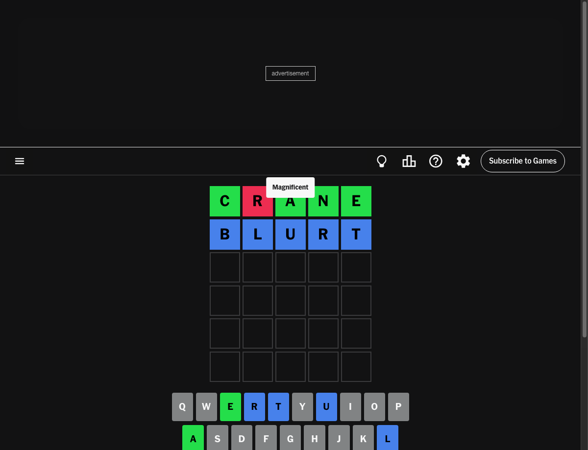
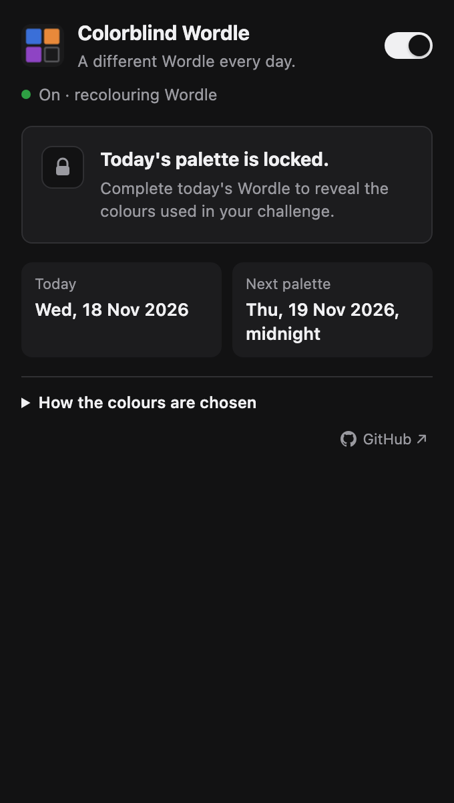
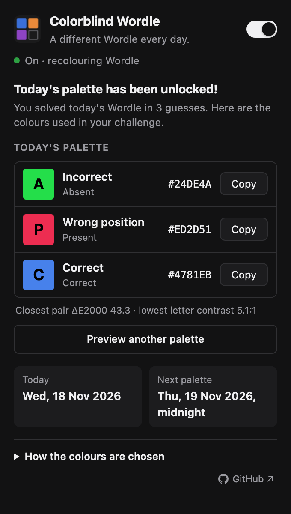
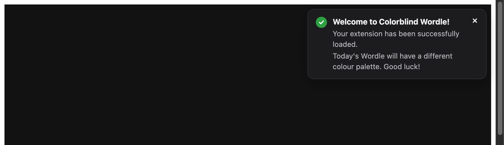
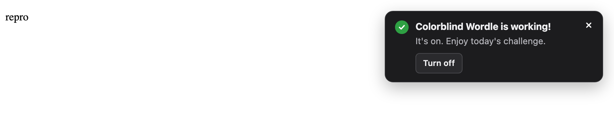

# Colorblind Wordle

A browser extension for Chrome and Firefox that replaces NYT Wordle's gray, yellow and green with **three new colours every day**. Everyone who plays on the same date gets **exactly the same three hex colours**: there is no server, account, tracking or network access.

Only the colours change. Wordle's game logic, guesses, answer checking, statistics and streaks are not touched.



| Before finishing today's Wordle | After finishing (won or lost) |
|---|---|
|  |  |

| First visit | Later visits |
|---|---|
|  |  |

---

## How the daily colours are generated

All the logic is in [`color-engine.js`](color-engine.js), a dependency-free module shared by the content script, the popup and the tests.

1. **Date.** Take the browser's *local* calendar date as `YYYY-MM-DD` (`getFullYear/getMonth/getDate`, never UTC).
2. **Seed.** Hash `APP_SEED | v<GENERATOR_VERSION> | daily|<date>` to a 32-bit integer (a cyrb53-style hash built on `Math.imul`). `APP_SEED` is one fixed string hard-coded in the extension.
3. **PRNG.** Feed that integer to **Mulberry32**, a small seeded pseudo-random generator.
4. **Candidate.** Draw a base hue, then place three hues about 120° apart with ±25° jitter, shuffle which state gets which hue, and choose saturation (45–85 %) and lightness (34–64 %) for each. Convert HSL to 8-bit RGB hex.
5. **Validate.** Convert each colour to CIE L\*a\*b\* (D65) and reject the candidate unless:
   - every pair differs by **CIEDE2000 ≥ 35**,
   - no two hex values are identical,
   - each colour's L\* is between 28 and 82 (not too dark or too bright),
   - each colour has **WCAG contrast ≥ 4.5:1** with black or white letters (the extension picks whichever is higher),
   - each colour stands out from both Wordle page backgrounds (light `#ffffff`, dark `#121213`), and
   - no colour resembles any of Wordle's own grays, yellows or greens (ΔE2000 ≥ 15).
6. **Retry.** If a candidate fails, draw the next one from the same PRNG stream (up to 400 attempts). Across 10 years of dates the worst case so far is 84 attempts and the median is 2.
7. **Fallback.** If all attempts fail, pick one of four pre-validated palettes deterministically (`seed % 4`). No date in the tested range has needed it.

The result is stored as `{ date, version, absent, present, correct, absentText, presentText, correctText }`.

### Why everyone gets the same colours

The output is a pure function of three inputs: **the local date, the fixed seed and the algorithm version**. Nothing else is read: no `Math.random()`, no installation ID, user, device, browser or location, and no storage. Two people anywhere, in any browser, run the same arithmetic on the same input and get the same output.

There is one more subtlety. JavaScript's `Math.pow`, `Math.cbrt`, `Math.sin`, `Math.atan2` and `Math.exp` are **not** guaranteed to give bit-identical results across engines, so Chrome (V8) and Firefox (SpiderMonkey) can differ in the last bit. Near a threshold (for example a ΔE of 34.99999 against 35.00001), that difference could produce different palettes. To rule this out, the engine implements those functions itself (`DMath`) using only operations IEEE 754 defines exactly (`+ − × ÷`, `Math.sqrt`, `Math.floor`, `Math.round`, `Math.imul`). Every engine therefore produces the same bits, and a test enforces that the engine never calls the built-in transcendental functions.

The date is the **local** calendar date by design, so the palette changes at the player's own midnight, just as Wordle's puzzle does. Someone in Tokyo and someone in New York see the same colours whenever their calendars show the same date.

### Local storage is only a cache

The content script writes today's palette to `chrome.storage.local` / `browser.storage.local` (key `cbw.palette`), along with your on/off preference (`cbw.prefs`). The palette is **always recomputed** from the date and seed, and the stored copy is never read back as a source of colours. Clearing storage or tampering with it cannot change what you see, and the tests check exactly that. The cache only avoids redundant writes and lets you inspect the current record.

---

## Hidden palette, unlocked by finishing the game

Knowing the colours in advance would spoil the puzzle, so the popup **keeps today's palette locked until you finish today's Wordle**, whether you win or use all six guesses.

- **While locked**, the popup shows the on/off toggle and status, a "Today's palette is locked." message, today's date, the next palette change and the GitHub link. It never computes or renders the palette: there are no swatches, hex codes, Delta E figures or preview button, and none of the day's colours appear anywhere in the popup's HTML.
- **Once unlocked**, it shows the three colours with hex codes and copy buttons, the perceptual distance and contrast figures, and **Preview another palette**. Previews are clearly labelled, use a separate seed namespace, and never change the official palette or the colours on the page.

### How completion is detected

[`game-state.js`](game-state.js) reads Wordle's board (it never writes to it):

| Element | Markup |
|---|---|
| Board | `[class*="Board-module_board"]` |
| Guess rows (6) | `[role="group"][aria-label="Row N"]` |
| Tiles (5 per row) | `[data-testid="tile"]`, with `data-state` and `data-animation` |

A row counts only once Wordle has **accepted and fully revealed** the guess: all five tiles are `absent`, `present` or `correct`, and their flip animation has finished. Typed letters (`tbd`) and rejected words never count.

- **Win:** an evaluated row with all five tiles `correct`.
- **Loss:** all six rows evaluated, with no winning row.

To be safe, the content script also:

- re-reads the board 1.2 seconds later and records the result only if it hasn't changed, so a briefly rendered stale board can't unlock anything;
- counts only the daily page (`/games/wordle/index.html`), never archive puzzles;
- counts only a puzzle loaded today (a game finished after midnight without reloading is yesterday's puzzle);
- stores `cbw.completion = { completedDate: "YYYY-MM-DD", result: "win" | "loss", guesses }` once per date.

The popup unlocks only when `completedDate` equals today's local date. Refreshing or restarting the browser keeps a finished day unlocked, and each new day starts locked. Refreshing, opening the popup or making a wrong guess can't unlock the palette, because none of them produces a finished board.

## In-page notification

When Wordle opens, a small dark notification appears in the top-right corner (full width on phones):

- **First activation per installation:** "Welcome to Colorblind Wordle!", with a success check and a dismiss button. It closes after 8 seconds.
- **Later visits:** "Colorblind Wordle is working!", with a **Turn off** button. It closes after 5 seconds and appears at most once every 30 minutes, so refreshing doesn't repeat it. Turn off restores Wordle's original colours immediately, and the popup toggle turns it back on.

It pauses its timer while hovered or focused. It is rendered in a closed shadow DOM (see [`notice.js`](notice.js)), so Wordle's styles can't touch it and it can't touch Wordle. It never takes keyboard focus, so typing and Enter still go to the game. It is not shown while the extension is turned off.

## How it hooks into Wordle

The selectors were checked against Wordle's live markup and CSS bundle:

| Element | Markup |
|---|---|
| Board tile | `div[data-testid="tile"][data-state="empty\|tbd\|absent\|present\|correct"]` |
| Keyboard key | `button[data-key][data-state="absent\|present\|correct"]` |
| Theme | `body.dark`, `body.colorblind` (high contrast) |
| Colour variables | `--color-absent/present/correct`, `--key-bg-*`, `--key-evaluated-text-color*` |

- **`content.js`** computes the palette, writes it to custom properties on `<html>` (`--cbw-absent`, `--cbw-present`, `--cbw-correct` and `--cbw-*-text`) and adds `html.cbw-enabled`.
- **`styles.css`** recolours evaluated tiles and keys, and overrides Wordle's own colour variables on `body`, `body.dark` and `body.colorblind`. That also recolours the win toast, share buttons, statistics bars and settings switches in both themes. Every rule is scoped to `html.cbw-enabled`, so turning the extension off restores the original look instantly.
- Only `background-color` and `color` are changed. Empty and typed-but-unsubmitted tiles (`empty`, `tbd`) are never matched, and borders, transforms and the flip and pop animations are untouched.
- One **`MutationObserver`** watches for revealed tiles and keyboard updates (`data-state` changes) and for anything resetting `<html>`. It batches work into one check per animation frame and writes only when something is actually missing, so it cannot cause a feedback loop.

### Automatic daily updates

The date is re-checked on page load, on `visibilitychange`, `focus` and `pageshow`, at local midnight (via a timer), every 60 seconds while visible (a safety net for sleep or throttled timers), and whenever a tile is revealed. When the date changes, the new palette is generated, cached, and written to the CSS variables. Every existing tile and key repaints immediately, with no reload.

---

## Install

### Chrome (or Edge, Brave and other Chromium browsers)

1. Open `chrome://extensions`.
2. Turn on **Developer mode** (top right).
3. Click **Load unpacked** and select the `colorblind-wordle` folder (the one containing `manifest.json`).
4. Open [Wordle](https://www.nytimes.com/games/wordle/index.html). Click the extension's icon (pin it from the puzzle-piece menu) to see today's palette.

### Firefox (temporary install)

Firefox needs its own manifest, so build first:

```bash
npm run build
```

1. Open `about:debugging#/runtime/this-firefox`.
2. Click **Load Temporary Add-on…** and choose `dist/firefox/manifest.json`.
3. Open Wordle. Temporary add-ons are removed when Firefox restarts.

Firefox 140 or later (Firefox for Android 142 or later) is required.

If Wordle keeps its normal colours, open the extension's popup. Its status line shows what is actually happening:

| Status | Meaning |
|---|---|
| On · recolouring this Wordle tab | Working |
| Needs permission to run on Wordle | Click **Allow on Wordle** (or choose "Always allow on www.nytimes.com" from Firefox's extensions menu), then reload Wordle |
| On · reload the Wordle tab to apply | The tab was opened before the extension was installed or allowed |
| Off · Wordle shows its original colours | Switched off with the toggle or the in-page Turn off button | To publish on addons.mozilla.org, see [FIREFOX.md](FIREFOX.md).

---

## Testing

Requires Node 22.2 or later. There are no npm dependencies.

```bash
npm test
```

This runs 69 unit and integration tests (`tests/*.test.js`, using Node's built-in test runner):

- identical dates give identical palettes; 5 simulated installations (separate JS realms with different user agents, storage contents and a `Math.random` that throws) agree on 60 consecutive days
- 10 years of consecutive dates (3,653) are all different, and every one passes ΔE2000 ≥ 35, contrast, brightness and uniqueness checks without the fallback
- golden reference vectors (`tests/golden.json`) match
- the date key is local, not UTC (checked in child processes with `TZ=Pacific/Kiritimati`, `Pacific/Honolulu` and `UTC`), and the same local date in four time zones gives the same palette
- CIEDE2000 matches the Sharma, Wu & Dalal reference data; WCAG contrast matches known values; the custom maths agrees with `Math` to under 1e-13
- the content script, run against a simulated page, storage and clock: applies the palette on load; keeps it identical on refresh and restart; ignores cleared or tampered storage; switches palettes at midnight, on tab focus, on visibility and on tile reveal; turns on and off from the popup's preference; makes zero writes on irrelevant mutations; works with both `chrome.*` callbacks and Firefox's promise-based `browser.*`; makes no network calls
- completion and unlock: wins and losses unlock today; wrong guesses, rejected words, rows still flipping, refreshes before finishing, stale boards, archive puzzles and yesterday's puzzle finished after midnight don't; a finished day stays unlocked across refreshes and restarts; the next day starts locked; malformed records never unlock
- notification: the welcome appears once per installation, the working notice appears on later visits but not on every refresh, both auto-dismiss and can be closed, Turn off restores the original colours, it can be re-enabled, and nothing shows while the extension is off. The test timers throw "Illegal invocation" if misused, just like a browser's
- Firefox mode: every content script runs with a `window` object that is separate from the global scope, and with a `browser.storage` that rejects callbacks, both as in Firefox. This reproduces the 1.1.0 bug where nothing happened in Firefox
- static checks: no network APIs or URLs in the source (apart from the GitHub link and the Wordle match pattern), CSS is scoped and colour-only, and the two manifests are identical apart from Firefox's `browser_specific_settings`, with only the `storage` permission

### Cross-browser parity

```bash
node tests/engine-parity.mjs
```

Runs the engine in every JavaScript engine it can find (Node/V8, macOS JavaScriptCore, a SpiderMonkey shell if installed, and headless Chromium-family browsers) and checks that each one reproduces the golden palettes for 3,653 days. To check **Firefox** manually, open [`tests/parity.html`](tests/parity.html) in Firefox. It must say **RESULT: PASS**. The same page works in any browser.

### Popup in a real browser (offline)

```bash
npm run build
node tests/popup-browser.mjs
```

This loads the packaged extension into a throwaway headless Chromium-family profile. It sets completion records directly in extension storage and checks the popup: locked on a fresh install and when only yesterday is completed, with no swatches, hex codes, metrics, preview button or daily colours in the HTML; unlocked after a win or a loss, with the right hex codes, metrics, copy buttons and preview button; unlocking live while open; previews never changing the official palette; invalid records staying locked; the on/off toggle; and the GitHub link opening the repository in a new tab. It needs no internet access.

### End-to-end on the real Wordle

```bash
npm run build
node tests/live-wordle.mjs          # win: CRANE, then the day's answer
node tests/live-wordle.mjs --lose   # loss: six wrong guesses
```

This launches a headless Chromium-family browser with a **throwaway profile** and the packaged extension, opens the live Wordle and chooses "Reject all" on the consent banner. On the first visit it checks the welcome notice and that the popup is locked, and that it stays locked after a wrong guess. It then finishes the game and checks that the popup unlocks. After a reload it checks the "working" notice, that Turn off restores the original colours, that the popup turns it back on, and that the palette stays unlocked. It also checks:

- tiles and keys in all three states have today's colours and the correct letter colours
- empty tiles are untouched
- Wordle still registers the win
- light and dark themes both work
- a simulated date change repaints the open page
- the popup shows the same hex codes, previews don't change the page, and the on/off toggle restores Wordle's original gray
- a reload keeps the palette
- the extension makes zero network requests

It needs internet access. Set `CBW_BROWSER=/path/to/browser` to choose the browser. Don't run it in a tight loop, because the NYT site rate-limits automated browsers.

### Simulating a date change by hand

On a Wordle tab, open DevTools, switch the console's context dropdown from "top" to **Colorblind Wordle**, then run:

```js
const Real = Date, shift = 86400000;
Date = class extends Real { constructor(...a) { a.length ? super(...a) : super(Real.now() + shift); } static now() { return Real.now() + shift; } };
CBWContent.checkDate();   // repaints with tomorrow's palette
```

Reload the tab to go back to today's palette. To preview any date without touching a page, run this in a terminal:

```bash
node -e "console.log(require('./color-engine.js').getPaletteForDate('2026-12-25'))"
```

---

## Packaging for distribution

```bash
npm run build
```

This produces:

- `dist/chrome/` and `dist/colorblind-wordle-chrome-<version>.zip`, ready for the Chrome Web Store
- `dist/firefox/` and `dist/colorblind-wordle-firefox.zip`, ready for addons.mozilla.org (see [FIREFOX.md](FIREFOX.md) and the [validation report](docs/firefox-validation-report.md))

The zips are written by a small built-in zip writer with fixed timestamps, so builds are reproducible. Bump `version` in **both** manifests before a release. `npm run icons` regenerates the PNG icons.

> **Changing the algorithm:** any change to `APP_SEED`, the rules or the generator changes everyone's palettes. Bump `GENERATOR_VERSION`, regenerate `tests/golden.json`, and ship to all browsers at the same time, so that users on different versions don't see different colours.

---

## Privacy

- Permissions: `storage`, plus host access to `https://www.nytimes.com/games/wordle/*` only, which is the same as the content script match. The content script runs only there.
- No background script, no analytics, no remote code, no network requests (extension pages also set `connect-src 'none'`).
- To detect the end of the game, the content script reads the board's tile states locally. It never reads the letters you typed, the answer or your statistics. Storage holds only the palette cache, your on/off preference, `{ completedDate, result, guesses }` for the last finished day, and when the notification was last shown. Nothing leaves the browser.
- The colours have to be applied to the page, so anyone who opens DevTools on the Wordle tab, or reads the open-source algorithm, can find them. The extension's own UI never shows them before you finish.
- Works fully offline once installed.

## Project layout

```
colorblind-wordle/
├── manifest.json            Chrome / Chromium (MV3)
├── manifest.firefox.json    Firefox (MV3 + gecko settings)
├── color-engine.js          deterministic palette engine (shared)
├── storage.js               chrome/browser storage wrapper (shared)
├── game-state.js            read-only game-over detection
├── notice.js                in-page welcome / working notification
├── content.js               Wordle integration
├── styles.css               colour overrides
├── popup/                   popup.html, popup.css, popup.js
├── icons/                   16, 32, 48 and 128 px
├── scripts/                 build.mjs (packaging), make-icons.mjs
├── tests/                   unit, integration, popup, parity and live tests
└── docs/screenshots/
```
